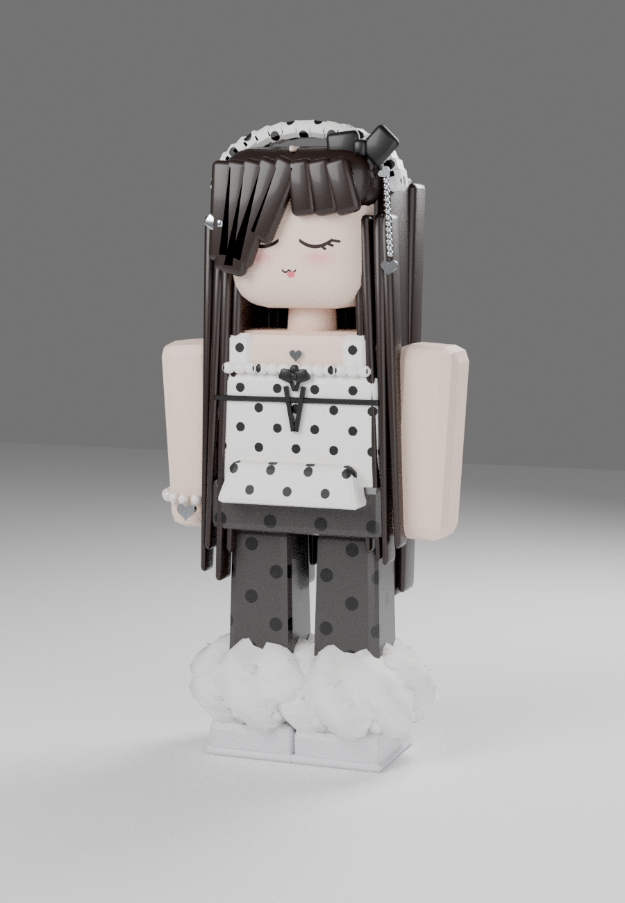

# Polka Dot Girl, Roblox style, built in Blender

A blocky Roblox-style girl based on the reference picture. She has very long dark-brown hair with a centre part and bangs swept over one eye, a white polka-dot headband with a black bow, silver heart charms and a dangling chain, and a little bow hair clip. Her face has closed happy eyes, blush and a tongue-out smile. She wears a white polka-dot top with frills and a black ribbon, a heart necklace, a pearl heart bracelet, grey polka-dot baggy pants, fluffy white leg warmers and chunky white shoes.



Reference: [`reference/polka_girl_reference.jpg`](reference/polka_girl_reference.jpg).

| File | Use |
| --- | --- |
| `build_polka_girl.py` | Builds the whole character. Colours are at the top; edit part sizes and positions and re-run. |
| `out/polka_girl.fbx` | For Roblox Studio's 3D Importer (textures embedded). |
| `out/polka_girl.glb` | glTF binary, same model (Roblox Studio, web viewers). |
| `out/polka_girl.blend` | Blender scene with textures packed, lights and camera. |
| `out/polka_girl_render.png` | Cycles preview render. |
| `out/tex_*.png` | The textures: face, top, pants and headband polka dots. |

## Rebuild

```sh
blender -b -P build_polka_girl.py -- out              # Blender 4.2+
python3.11 build_polka_girl.py out                    # or with the bpy module (pip install bpy)
python3.11 build_polka_girl.py out --no-render        # skip the ~35 s render
```

## Importing into Roblox Studio

- Home/Avatar tab → **Import 3D** → pick `out/polka_girl.fbx` (or the `.glb`).
- She comes in as 11 MeshParts, one per material, each with one texture: `Skin`, `Head` (face texture), `Hair`, `Top`, `Pants`, `Fur`, `Shoes`, `Headband`, `Ribbon`, `Silver`, `Pearl`.
- She is about 17k triangles in total. The largest part (`Hair`) is about 4.9k, well under Roblox's 20k-per-MeshPart limit.
- Scale: built at 1 stud = 0.28 m, so she imports at normal character height, about 5.6 studs.
- As imported she is a **static model**, good for a statue, showcase or NPC. Anchor her, or weld the parts together.
- To make her a **playable avatar**, run the model through Studio's **Avatar Setup** tool (Avatar tab), which rigs a body to R15. The hair, headband and bow can also be set up as separate accessories with the **Accessory Fitting Tool**. Selling it on the marketplace needs UGC access and goes through Roblox moderation.
