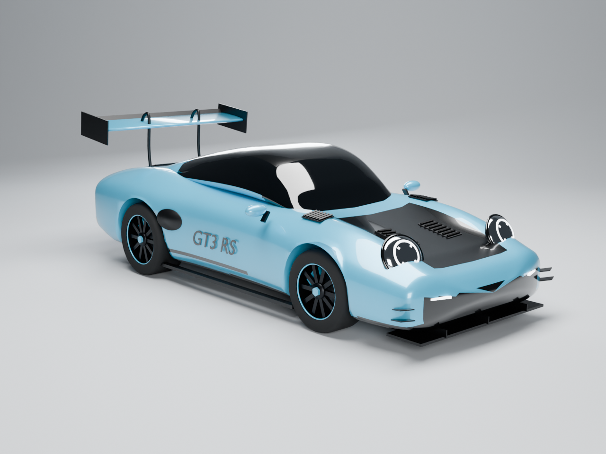

# Porsche 911 GT3 RS (992) — Blender model

A procedural, stylised GT3 RS in a Gulf-blue livery: black hood and roof, swan-neck wing, black 10-spoke centre-lock wheels with blue pinstripes.



| File | Use |
| --- | --- |
| `build_gt3rs.py` | Builds the whole car from code. Edit the profile tables or `PAINT_HEX` and re-run. |
| `out/gt3rs.blend` | Blender 4.2 scene: car (collection `GT3RS`) + studio, lights and camera (collection `Studio`). |
| `out/gt3rs.glb` | glTF binary, car only — Roblox Studio (3D Importer), three.js, web viewers. |
| `out/gt3rs.fbx` | FBX, car only — Roblox Studio, Unity, Unreal. |
| `out/gt3rs_render.png` | Cycles preview render. |

## Rebuild

```sh
blender -b -P build_gt3rs.py -- out            # with Blender installed
python build_gt3rs.py out                      # or with `pip install bpy` (Python 3.11)
python build_gt3rs.py out --no-render          # skip the ~2 min Cycles render
```

## Notes

- Units are metres; +X is the front of the car, +Z up. In Roblox, scale the imported model (1 stud ≈ 0.28 m, so roughly ×3.6) to taste.
- 162 parts, ~58k triangles; every single mesh is under Roblox's 20k-triangle MeshPart limit (the body is the largest at ~19k).
- The shape is modelled from published dimensions (4.57 m long, 2.46 m wheelbase), not scanned, so it is a stylised likeness.
