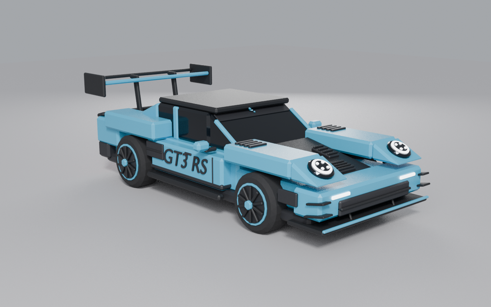

# Porsche 911 GT3 RS (992), Roblox style, built in Blender

A blocky, Roblox-feel GT3 RS: chunky bevelled parts, wedge slopes, flat-shaded smooth-plastic materials and fat wheels. It follows the reference photo's livery: Gulf-blue body, black hood and roof, swan-neck wing, "GT3 RS" door script, windshield banner and black wheels with blue pinstripes and centre locks.



Reference: [`reference/gt3rs_reference.jpg`](reference/gt3rs_reference.jpg). The build script samples the paint colour from this photo and packs it into the `.blend` as a reference image in the `Reference` collection. It is not rendered or exported.

| File | Use |
| --- | --- |
| `build_gt3rs_roblox.py` | Builds the whole car in Blender. Edit part sizes and positions and re-run. |
| `out/gt3rs_roblox.blend` | Blender scene: car (`GT3RS_Roblox`), baseplate, lights, camera (`Studio`) and the reference photo. |
| `out/gt3rs_roblox.fbx` | Car only, for Roblox Studio's 3D Importer. |
| `out/gt3rs_roblox.glb` | Car only, glTF binary (Roblox Studio, web viewers). |
| `out/gt3rs_roblox_render.png` | Cycles preview render. |

## Rebuild

```sh
blender -b -P build_gt3rs_roblox.py -- out             # Blender 4.0+; glTF export needs numpy
blender -b -P build_gt3rs_roblox.py -- out --no-render # skip the ~40 s Cycles render
```

## Importing into Roblox Studio

- Avatar/Home tab → **Import 3D** → pick `out/gt3rs_roblox.fbx` (or the `.glb`).
- The car comes in as 10 MeshParts: `Body`, `Glass`, `Trim`, `Lamps`, `Aero`, `Livery` and four wheels, `Wheel_FL/FR/RL/RR`.
- Each wheel's origin is at its hub, so you can hinge it to the chassis directly with a `HingeConstraint` (or `CylindricalConstraint` for steering).
- All parts together are about 16k triangles, and the largest part (`Livery`) is about 5.7k, well under Roblox's 20k-per-MeshPart limit.
- Units are metres (+X forward). The car is about 4.9 m long. If you want it at Roblox character scale (1 stud ≈ 0.28 m), scale it by about 3.6.
