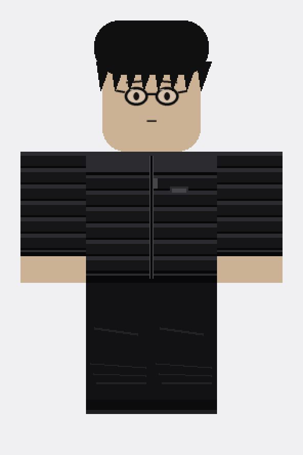

# Shadow Puffer avatar (Roblox)

A Roblox character based on the reference: messy black hair, round black glasses, black quilted puffer jacket with a hood collar, baggy black pants, black shoes, light tan skin.

| File | Use |
| --- | --- |
| `out/shirt_template.png` | Classic **Shirt** (585×559). Black puffer jacket, hood collar, zip. Hands left clear so skin shows. |
| `out/pants_template.png` | Classic **Pants** (585×559). Baggy black pants with folds and a cargo pocket, black shoes. |
| `out/face_decal.png` | **Face** decal (256×256, transparent). Round glasses and a calm expression. |
| `out/preview_front.png` | Flat front preview of the whole look. |
| `roblox/AvatarConfig.lua` | ModuleScript with every setting: skin colour, clothing/face IDs, hair and glasses IDs, body scale, animations. |
| `roblox/BuildAvatar.server.lua` | Script that builds the R15 rig from the config and can dress every player. |
| `build_templates.py` | Redraws the PNGs. Colours and sizes are at the top. `python3 build_templates.py` (needs Pillow). |

## Upload to Roblox

1. **create.roblox.com → Creations → Avatar Items → Classic Shirts → Upload** `out/shirt_template.png`. Do the same for **Classic Pants** with `out/pants_template.png`. Uploading clothing costs a small Robux fee and goes through moderation.
2. Upload `out/face_decal.png` as a **Decal**.
3. Copy each item's ID from its URL.
4. In Roblox Studio:
   - Add a **ModuleScript** to `ReplicatedStorage`, name it `AvatarConfig`, paste `roblox/AvatarConfig.lua`.
   - Add a **Script** to `ServerScriptService`, paste `roblox/BuildAvatar.server.lua`.
5. In `AvatarConfig`, set `ShirtId`, `PantsId`, `FaceId`, and pick a messy black hair (and glasses, if you want 3D ones) from the catalog for `HairIds` / `GlassesIds`.
6. Press Play. A rig named `ShadowPuffer` appears at `RigPosition`. Set `ApplyToPlayers = true` to make every player wear it.

To wear it on your own account instead, buy/own the items and equip them in the Avatar Editor: skin colour `#CCB295`, the shirt, pants, face, hair and glasses.
